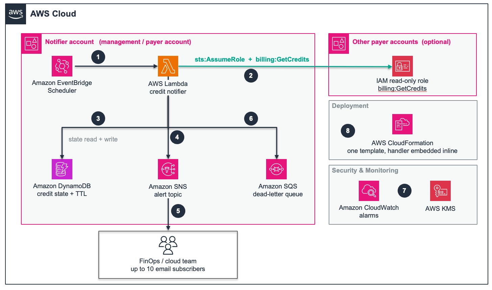

# AWS Credits Notifier

Get an email when an AWS credit is assigned to your account, and again as each
credit approaches its expiry date.

Pure CloudFormation. Deploy from the console - no CLI, no S3 bucket, no zip to
build, no Lambda layer.

See [Architecture](#architecture) for the diagram and a step-by-step walkthrough
of how it works.

---

## Why this exists

AWS has no built-in way to be told about credits:

| Service | Covers credits? |
|---|---|
| AWS Budgets | No - tracks **spend**, not credit assignment or expiry |
| AWS User Notifications | No - there is no credit event type |
| Amazon EventBridge | No - AWS emits no credit event |
| Billing console *Credits* page | Shows them, but you have to go and look |

This polls the `billing:GetCredits` API daily, remembers what it saw last time,
and emails you only when something actually changes.

---

## Architecture

[](assets/credits-notifier-architecture.png)

*Click the diagram to open it full size.*

The numbers below match the numbered steps in the diagram.

| # | What happens |
|---|---|
| 1 | **Amazon EventBridge Scheduler** invokes the notifier once a day. Estimated credit balances only refresh every 24 hours, so daily is the useful maximum. |
| 2 | The function calls `billing:GetCredits` - its own account directly, and each other payer account by assuming a read-only IAM role there. A payer account returns credits for its whole consolidated billing family. |
| 3 | Each credit is compared against **DynamoDB** state keyed `accountId#creditId`, which records the expiry thresholds already alerted on. This is what turns a daily poll into change detection, and what stops the same warning arriving every morning. |
| 4 | A credit never seen before, or one crossing a 90 / 60 / 30 / 7 day threshold, is published to the **SNS** topic. Unchanged credits produce nothing. |
| 5 | Subscribers receive the alert by email. State is written back so each threshold fires exactly once, and a DynamoDB TTL clears rows once credits are long expired. |
| 6 | Invocations that fail outright land in an **SQS** dead-letter queue, retained 14 days. |
| 7 | **CloudWatch** alarms watch the notifier itself - any error, or no invocation in 48 hours - and publish to the same topic, because silence from a notifier is otherwise indistinguishable from good news. |
| 8 | Everything is deployed from one **CloudFormation** template with the handler embedded inline. Adding a payer account means deploying a single IAM role there, then extending one parameter. |

Three kinds of email arrive:

| Email | When |
|---|---|
| **Credit assigned** | Once, when a credit first appears with time still left on it |
| **Expiring in N days** | Once per threshold, so a 120-day credit yields four warnings, not 120 |
| **Monitoring enabled** | One inventory email the first time an account is scanned, instead of one alert per existing credit |

The diagram is editable - [open the PowerPoint source](assets/credits-notifier-architecture.pptx).

---

## Cost

You are responsible for the cost of the AWS services used while running this
solution. As of September 2026, the cost for running this solution with the
default settings in the US East (N. Virginia) Region is approximately **$1.20
per month** for monitoring one payer account with up to 10 active credits,
checked once per day.

The following table provides a sample cost breakdown for deploying this solution
with the default parameters in the US East (N. Virginia) Region for one month.

| AWS Service | Dimensions | Cost [USD] |
|---|---|---|
| AWS KMS | 1 customer-managed key, plus a few thousand encrypt/decrypt requests | $1.00 |
| Amazon CloudWatch | 2 standard-resolution alarms at $0.10 each | $0.20 |
| Amazon EventBridge Scheduler | 1 schedule, ~31 invocations per month | $0.00 |
| AWS Lambda | ~31 notifier invocations, 256 MB, arm64, a few seconds each | $0.00 |
| Amazon DynamoDB | 1 table, on-demand, under 1 MB stored, point-in-time recovery enabled | $0.00 |
| Amazon SNS | ~31 publishes, up to 10 email subscriptions | $0.00 |
| Amazon SQS | 1 dead-letter queue, 0 messages in normal operation | $0.00 |
| Amazon CloudWatch Logs | 3 log groups, under 10 MB ingested, 30-day retention | $0.00 |
| AWS Billing | ~31 `billing:GetCredits` calls per monitored account | $0.00 |
| AWS CloudFormation | 1 stack, only `AWS::*` resource types | $0.00 |
| AWS Identity and Access Management | 4 roles | $0.00 |
| **Total estimated cost** | | **~$1.20/month** |

The customer-managed KMS key is the dominant cost at $1.00/month flat, plus a
small per-request charge. Everything else effectively rounds to zero: 31 Lambda
invocations a month against a free-tier allowance of a million, and a DynamoDB
table holding one row per credit. If you do not need a customer-managed key,
encryption with AWS-managed keys is cheaper - but the template ships with a
customer-managed key by default to satisfy common security-baseline checks.

Two things worth knowing about how this scales:

- **Adding payer accounts barely moves the bill.** Each extra account adds one
  `billing:GetCredits` call and a few seconds of Lambda duration per day. The
  KMS key and alarms are fixed, so the total stays near $1.20 whether you monitor
  one account or twenty.
- **The API choice matters more than the volume.** This solution reads credits
  with the AWS Billing API, which AWS does not price per request. The
  [AWS Cost Explorer API](https://aws.amazon.com/aws-cost-management/aws-cost-explorer/pricing/)
  charges $0.01 per request, so polling it daily would add about $0.31 per
  month per account - more than the rest of the solution combined.

We recommend creating a [Budget](https://docs.aws.amazon.com/cost-management/latest/userguide/budgets-managing-costs.html)
through [AWS Cost Explorer](https://aws.amazon.com/aws-cost-management/aws-cost-explorer/)
to help manage costs. Prices are subject to change. For full details, refer to
the pricing webpage for each AWS service used in this solution.

---

## Files

**To deploy, you need these two - nothing else:**

| File | Purpose |
|---|---|
| `main.yaml` | The notifier. Deploy this. Carries the handler inside it, so it is the only file needed for a single account. |
| `other-payers.yaml` | One read-only IAM role. Only needed for extra payer accounts. |

**Everything else is reference or maintainer tooling. You do not run any of it to
deploy, and after deployment the only changes most people make are parameter
updates - recipients, or the list of payer accounts.**

| File | Purpose |
|---|---|
| `src/credit_notifier.py` | The Lambda handler in readable form. `main.yaml` carries it compressed, so this is what you read to review or audit what actually runs. |
| `src/build.py` | Re-embeds the handler into `main.yaml` if you change it, and `--check` proves the embedded copy still matches this source. |
| `tests/preflight.sh` | Testing. Optional check that `billing:GetCredits` works before you deploy |
| `tests/test-alerts.sh` | Testing. Proves the alert types work without waiting for real credits |
| `assets/credits-notifier-architecture.pptx` | Editable source for the architecture diagram |
| `assets/credits-notifier-architecture.png` | The rendered diagram shown above |

---

## Before you start

Deploy into a **management (payer) account**. Credits are visible there, and the
notifier asks for the whole consolidated billing family, so one payer account
covers all of its linked accounts.

Optional but recommended - confirm the API is reachable from that account:

```bash
./tests/preflight.sh
```

It tries the AWS CLI, falls back to Python, and reports whether the account is a
payer account. `PASS` means you are good to deploy.

---

## Deploy: one payer account

1. Sign in to the payer account. **CloudFormation → Create stack → With new
   resources**.
2. **Upload a template file** → choose `main.yaml`.
3. Stack name: `credit-notifier`. All resources are named from it.
4. Set **`NotificationEmails`** to your address. For several recipients, separate
   with commas and **no spaces**, up to 10:
   ```
   finops@example.com,cloudops@example.com
   ```
5. Leave every other parameter at its default.
6. Tick **"I acknowledge that AWS CloudFormation might create IAM resources with
   custom names"**, then **Create stack**. Takes 2-3 minutes.

That is the whole deployment. Now finish setup:

7. **Click the confirmation link** in the "AWS Notification - Subscription
   Confirmation" email. Until you do, no alerts are delivered and nothing warns
   you about it.
8. Run it once rather than waiting for the schedule. **Lambda → Functions →
   `credit-notifier-notifier` → Test** with any event, or:
   ```bash
   aws lambda invoke --function-name credit-notifier-notifier \
     --region us-east-1 /dev/stdout
   ```
   You want `"failures": []`, and one email listing your current credits.

---

## Deploy: several payer accounts

One stack monitors many payer accounts. Each **additional** account needs a
read-only role first, because a CloudFormation stack can only create resources in
its own account.

Say the notifier will run in `111122223333`, and you also want `222233334444` and
`333344445555` monitored.

The spoke role trusts one specific hub role, not the whole hub account, so you
need the hub's notifier role name before deploying the spokes. It is
`<your main.yaml stack name>-notifier-role`. If you name the notifier stack
`credit-notifier-stack`, the role is `credit-notifier-stack-notifier-role`. After
the hub is deployed you can also read it back from that stack's **Outputs** tab as
`NotifierRoleName`; it is worth confirming there rather than typing it by hand.

### Step 1 - the role, in each additional account

In `222233334444`, then again in `333344445555`:

1. Sign in to that account. **CloudFormation → Create stack → With new
   resources**.
2. **Upload a template file** → choose `other-payers.yaml`.
3. Stack name: `credit-notifier-role`.
4. Set **`HubAccountId`** to `111122223333` - the account that will run the
   notifier.
5. Set **`HubRoleNamePattern`** to the hub role name above, for example
   `credit-notifier-stack-notifier-role`. A trailing `*` is allowed
   (`credit-notifier-stack-*`) so a later hub rename does not break the trust.
   This is what stops any other principal in the hub account from assuming the
   role.
6. Leave `RoleName` at its default. It must be identical in every account.
7. Tick the IAM acknowledgement, **Create stack**. A few seconds.

Do **not** deploy this in `111122223333`. The notifier reads its own account
directly, and a role that trusts itself would serve no purpose.

### Step 2 - the notifier, in the main account

In `111122223333`, deploy `main.yaml` exactly as in the single-account section,
but also set:

```
TargetPayerAccounts = 111122223333,222233334444,333344445555
```

> **List every account you want monitored, including this one.**
> `TargetPayerAccounts` *replaces* the account list rather than extending it.
> Leave out the account running the stack and it stops being monitored - quietly,
> with no error.

Then confirm the subscription and run a manual invoke as above.
**`accountsScanned` must equal the number of accounts you listed.** If it is
lower, check `failures` in the response - almost always a missing role or a wrong
`HubAccountId`.

### Adding a payer later

Deploy `other-payers.yaml` in the new account, then update the `main.yaml` stack
with the longer `TargetPayerAccounts`. No code change.

---

## What the emails look like

**A credit was assigned**

```
Subject: [AWS Credits] New credit assigned - 222233334444

A new AWS credit has been assigned to your account. You have 120 days to use it.

Account            : 222233334444
Description        : Migration Acceleration Program credit
Original amount    : USD 250,000.00
Remaining          : USD 250,000.00
Expires on         : 2027-07-31  (in 120 days)
Applies to         : All eligible services
```

**A credit is approaching expiry** - once at 90, 60, 30 and 7 days by default.
Each threshold fires once per credit, so a credit sitting at 45 days out does not
email you every morning.

**One setup email per account.** The first scan would otherwise report every
existing credit as new, so instead you get a single inventory listing them all,
soonest expiry first. After that, only real changes.

An already-expired credit seen for the first time is recorded but **not**
announced as new - it appears in the inventory marked expired, and nothing more.

---

## Testing it without real credits

Proving the **new credit** and **approaching expiry** paths normally means waiting
for AWS to assign a credit, then waiting months for it to near its expiry date.
Instead, pass synthetic credits in the invocation event:

```bash
./tests/test-alerts.sh -s credit-notifier -r us-east-1
```

That walks one credit through its whole life against your **deployed** function
and sends you real emails:

| Step | Simulated | Expected |
|---|---|---|
| 1 | new credit, 120 days left | 1 email - **NEW_CREDIT** |
| 2 | same credit, now 88 days | 1 email - **EXPIRING**, 90-day notice |
| 3 | next day, 87 days | silent - 90 already fired |
| 4 | 58 days | 1 email - **EXPIRING**, 60-day notice |
| 5 | 5 days, crossing 30 **and** 7 | 1 email only, not two |
| 6 | nearly spent, 10 days, USD 0.42 left | 2 emails - new **and** expiring |
| 7 | first seen already expired | silent - never announced as new |

Six emails in total. Steps 3 and 7 proving *silence* matter as much as the rest -
a notifier that alerts every morning gets muted, and one that announces
long-dead credits as new destroys trust in it.

Clean up the simulated state when you are done:

```bash
./tests/test-alerts.sh -s credit-notifier -r us-east-1 --cleanup
```

### Doing it by hand

Any single case, without the script:

```bash
aws lambda invoke --function-name credit-notifier-notifier --region us-east-1 \
  --cli-binary-format raw-in-base64-out \
  --payload '{"simulateCredits":[{"creditId":"TEST-1","endInDays":45,"amount":"5000.00"}]}' \
  /dev/stdout
```

`endInDays` saves computing epoch timestamps. `amount`, `remaining`,
`description` and `accountId` are all optional. Omit the end date entirely to
simulate a credit that never expires.

### Why this is safe in production

The simulated credits come from the **invocation event**, not configuration.
EventBridge Scheduler sends no `simulateCredits` key, so the daily run always
calls the real API - there is no setting left switched on by mistake. Every
invocation that uses it logs a `SIMULATION MODE` warning, and the function
returns `"simulated": true`.

State writes and emails are real, which is the point: de-duplication is genuinely
being tested. Use obviously-fake credit IDs and run `--cleanup` afterwards.

---

## Parameters

Only the first one usually needs setting.

| Parameter | Default | Notes |
|---|---|---|
| `NotificationEmails` | *(blank)* | Up to 10, comma separated, **no spaces**. Each must confirm. |
| `TargetPayerAccounts` | *(blank)* | Blank = this account only. Otherwise list **every** account to monitor. |
| `AssumeRoleName` | `AWSCreditsNotifierReadRole` | Must match `RoleName` in `other-payers.yaml`. |
| `ExternalId` | *(blank)* | Optional. The spoke roles are already scoped to this one hub role via `HubRoleNamePattern`, so leave blank unless a third party operates your hub. If set, use the identical value in every `other-payers.yaml` stack. |
| `ExpiryThresholdDays` | `90,60,30,7` | Days-before-expiry alert points. |
| `MinRemainingForExpiryAlert` | `0` | Set to e.g. `100` to stop nagging about nearly-spent credits. |
| `ScheduleExpression` | `cron(0 13 * * ? *)` | Daily 13:00 UTC. Balances refresh every 24h, so daily is the useful maximum. |
| `ScheduleState` | `ENABLED` | `DISABLED` deploys without starting the daily checks. |
| `ExistingSnsTopicArn` | *(blank)* | Publish into a topic you already own instead of creating one. |
| `SnsKmsKeyArn` | *(blank)* | Optional override. The stack creates its own KMS key and uses it for the topic by default; set this only to encrypt the topic with a different key you already own. |
| `LambdaRuntime` | `python3.13` | |
| `FunctionTimeout` | `300` | Raise it if you monitor many accounts. |
| `StateRetentionDays` | `400` | How long state rows outlive a credit. |
| `LogRetentionDays` | `30` | CloudWatch Logs retention. |

Need more than 10 recipients? Subscribe them to the topic afterwards, no stack
update needed:

```bash
aws sns subscribe --topic-arn <AlertTopicArn from stack Outputs> \
  --protocol email --notification-endpoint another@example.com
```

---

## What gets created

In the notifier account: a customer-managed KMS key, a DynamoDB table for state,
an SNS topic and subscriptions, three Lambda functions, an EventBridge schedule,
an SQS dead-letter queue, two CloudWatch alarms, four IAM roles, and three log
groups.

The KMS key encrypts the state table, the dead-letter queue, and the alert topic.
The third Lambda runs only at deploy time - it waits for the notifier's execution
role to become assumable before the function is created, which avoids an IAM
propagation race (see the troubleshooting note on stuck creates).

In each additional payer account: one IAM role, allowed exactly one action -
`billing:GetCredits`. It grants no access to spend, invoices, resources or any
other service.

Running cost is about USD 1-2 per month, almost entirely the customer-managed
KMS key at USD 1 plus a few cents of key requests. The compute is negligible -
one Lambda invocation a day, a handful of DynamoDB operations, and two alarms.

### Two design points worth knowing

**State is what makes this a notifier.** Without the DynamoDB table you could
only ever answer "what credits exist right now", which means mailing the full
list every day or nothing useful. State turns a poll into a *change* notification
and stops the same warning arriving 90 mornings running.

**The alarms watch the notifier itself.** Silence from a notification system
looks exactly like good news. The `-notifier-not-running` alarm treats missing
data as breaching, so a deleted schedule or broken function tells you rather than
quietly ending your credit visibility.

---

## Troubleshooting

**No email, but the invoke succeeded**
Almost always an unconfirmed subscription. Check **SNS → Subscriptions**; a
status of `PendingConfirmation` means nothing will be delivered. Otherwise, if
`alertsSent` is 0, nothing changed - which is the correct behaviour.

**`accountsScanned` is lower than the number of accounts listed**
Read `failures` in the invoke response, and the function logs:

| Message | Cause |
|---|---|
| `not authorized to perform: sts:AssumeRole` | Role missing in that account, or wrong `HubAccountId` |
| role not found | `AssumeRoleName` does not match the role's `RoleName` |
| `AccessDeniedException` on `GetCredits` | A Service Control Policy blocks billing actions there |

**Parameter validation failed**
Remove spaces after commas in `NotificationEmails` or `TargetPayerAccounts`.
Account IDs must be exactly 12 digits, and the email list is capped at 10.

**`Placeholder code still in place`**
The custom resource that installs the handler did not finish. Check the
`/aws/lambda/<stack>-code-installer` log group. Re-running the stack update
retriggers it.

**Emails stopped arriving**
The `-notifier-not-running` alarm covers this. Check the schedule still exists
and is `ENABLED` under **EventBridge → Scheduler → Schedules**.

**Re-testing an alert**
Delete a credit's row from the `<stack>-credit-state` DynamoDB table and it is
treated as new on the next run. The row key is `<accountId>#<creditId>`. Deleting
`__baseline__#<accountId>` replays the inventory email for that account.

**Failed invocations**
They land in the `<stack>-dlq` SQS queue, kept 14 days.

**A deploy failed, and now redeploying gives `... already exists`**
When a create fails and rolls back, any Lambda that ran once leaves its
`/aws/lambda/<stack>-*` log group behind - CloudFormation does not own those, so
the rollback cannot remove them. The next create with the same stack name then
collides on the log-group name. A first, clean deploy into a fresh account or a
never-used stack name does not hit this; it only happens when you retry a failed
stack under the same name. To recover, delete the rolled-back stack and the
leftover log groups, then redeploy:

```bash
aws cloudformation delete-stack --stack-name <stack> --region <region>
aws cloudformation wait stack-delete-complete --stack-name <stack> --region <region>
for lg in notifier code-installer role-propagation; do
  aws logs delete-log-group --log-group-name "/aws/lambda/<stack>-$lg" --region <region> 2>/dev/null || true
done
```

**A create sits at `CREATE_IN_PROGRESS` on an IAM role for many minutes**
This is IAM eventual consistency: a freshly created execution role is not yet
assumable by Lambda, so function creation can hang or fail with *"the role
defined for the function cannot be assumed by Lambda."* The template already
guards against this with a role-propagation custom resource that waits for the
role to become assumable before the functions are created. If you still see it,
delete and redeploy per the note above - a second attempt almost always clears
it as propagation completes.

---

## Notes for maintainers

**No boto3 layer is needed.** `GetCredits` is newer than the boto3 bundled with
Lambda runtimes, so `boto3.client("billing")` fails with `UnknownServiceError` on
most of them. The handler signs the request itself with `botocore.auth.SigV4Auth`,
which needs no service model. Verified against botocore 1.43.39, which has no
billing service model at all.

**The handler is embedded in `main.yaml`.** It is about 23 KB, far past
CloudFormation's 4096-byte inline code limit, so it travels as gzip + base64 and
a small inline function installs it during stack creation. This is why `main.yaml`
needs nothing staged in S3.

That means it uses a **Lambda-backed custom resource**. If your change-management
process disallows those, this template is not for you.

**After editing `src/credit_notifier.py`:**

```bash
./src/build.py           # re-embed it into main.yaml
./src/build.py --check    # verify main.yaml is current; exit 1 if stale
```

`--check` also confirms the embedded copy decodes byte-for-byte back to the
source, so a hand-edited template cannot silently diverge. Run it before
committing. If you change the installer logic itself, bump `InstallerVersion` in
`main.yaml` - a custom resource only re-runs when its own properties change.

**Auditing the embedded code** without deploying anything:

```bash
python3 - <<'EOF'
import base64, gzip, re
blob = re.search(r"^      SourceGz: \|\n((?:^ {8}\S.*\n)+)",
                 open("main.yaml").read(), re.M).group(1)
open("/tmp/extracted.py","wb").write(
    gzip.decompress(base64.b64decode("".join(blob.split()))))
EOF

diff /tmp/extracted.py src/credit_notifier.py && echo IDENTICAL
```

---

## Security

See [CONTRIBUTING](CONTRIBUTING.md#security-issue-notifications) for more information.

## License

This library is licensed under the MIT-0 License. See the [LICENSE](LICENSE) file.
